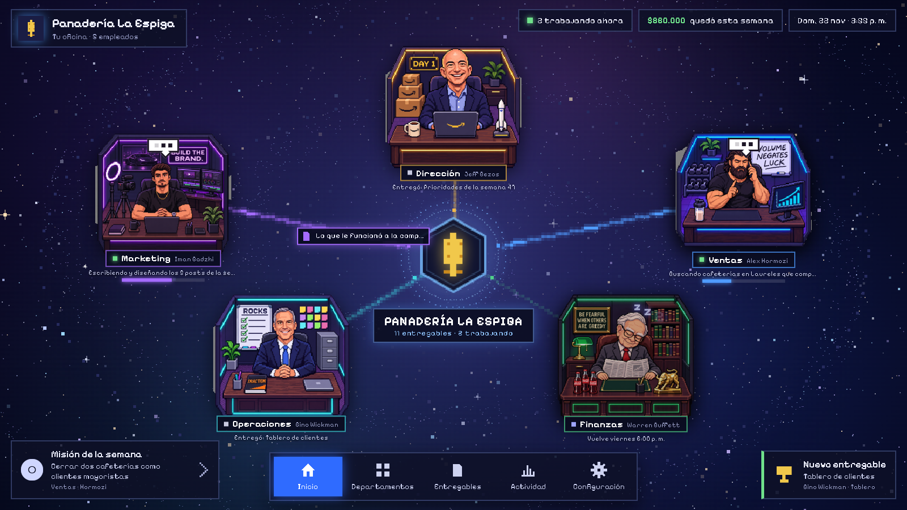

# Órbita



Cinco empleados de IA para tu negocio, cada uno con la forma de pensar de un empresario conocido. Cargas la información de tu negocio una vez y ellos trabajan solos a su horario: buscan clientes, escriben tus posts, llevan el tablero de clientes, revisan tus números y fijan las prioridades de la semana. Todo se ve en una oficina en pixel art donde puedes hablar con cada uno, encargarle algo o pedirle su opinión.

Corre en [Claude Code](https://claude.com/claude-code) con tu plan de Claude. No necesitas clave de API ni instalar nada más.

| Departamento | Lo lleva | Qué hace | Cuándo trabaja |
|---|---|---|---|
| Dirección | Jeff Bezos | Lee lo que entregó cada departamento y fija las 3 prioridades de la semana | Lunes 7:00 a. m. |
| Marketing | Iman Gadzhi | Mira qué le funciona a tu competencia, arma el plan de contenido y escribe los posts | Domingos 9:00 p. m. |
| Ventas | Alex Hormozi | Busca prospectos con su contacto, arma la oferta y escribe el primer mensaje para cada uno | Lunes y jueves 8:00 a. m. |
| Operaciones | Gino Wickman | Lleva el tablero de clientes y te dice a quién escribirle hoy | Todos los días 7:30 a. m. |
| Finanzas | Warren Buffett | Lee tus ingresos y gastos y te dice qué deja plata y dónde se te va | Viernes 6:00 p. m. |

## Qué necesitas

- [Claude Code](https://claude.com/claude-code) con la sesión iniciada en la terminal. Si solo lo has usado en la app de escritorio, abre una terminal, escribe `claude`, inicia sesión con `/login` y sal con `/exit`.
- [Node.js](https://nodejs.org) 20 o más nuevo.

## Empezar

```bash
git clone https://github.com/jorge-posada-focus/orbita.git
cd orbita
npm start
```

Abre http://localhost:4740. La primera vez ves una oficina de ejemplo, con una panadería inventada, para que sepas cómo se ve cuando ya está trabajando.

Para cargar tu negocio, abre otra terminal en la misma carpeta:

```bash
claude
```

y escribe `/contratar`. Te hace una sola tanda de preguntas: qué vendes y a qué precio, a quién le quieres vender, tu Instagram y tu competencia, cómo le hablas a tus clientes. Si le pasas el link de tu Instagram o tu web, primero investiga por su cuenta y solo te pregunta lo que no encontró. Si tienes tu lista de clientes o tus ingresos y gastos en Excel, también se los puedes dar.

## Cómo trabajan

Mientras `npm start` esté abierto, cada empleado trabaja solo a su hora. Si el computador estaba apagado a esa hora, recupera el turno al prenderlo, hasta 12 horas después. En la oficina ves en vivo qué está haciendo cada uno, sus pasos y lo que va anotando.

Desde la oficina, haz clic en cualquier empleado y elige:

- **Haz tu ronda**: trabaja ahora, sin esperar su horario.
- **Te encargo algo**: un pedido puntual, por ejemplo "búscame gimnasios del barrio que podrían comprarme".
- **Quiero tu opinión**: conversas con él sobre una idea o una decisión. Te responde con su forma de pensar y con lo que sabe de tu negocio, y la conversación queda guardada.

También puedes pedirles cosas desde Claude Code: `/oficina ronda` pone a trabajar a los cinco, y `/oficina ventas búscame clientes en Chapinero` le pide algo a uno.

Lo que entregan queda en `oficina/<departamento>/resultados/` y en la oficina, en **Entregables**. Nada se manda, se publica ni se compra solo: ellos dejan todo listo y tú decides.

## Lo que gasta de tu plan

Cada turno abre una sesión de Claude Code que gasta de tu plan, igual que si se lo pidieras tú. Un turno tarda de 2 a 5 minutos. Una consulta, menos de un minuto.

Con los horarios de arriba son 12 turnos a la semana. Si tu plan se queda corto, cambia los horarios en `app/puestos.json` (el campo `programa`: días de 0 a 6, donde 0 es domingo, y la hora en formato 24 horas).

Opciones al abrir la oficina:

| Variable | Qué hace |
|---|---|
| `OFICINA_TURNOS=0` | Apaga los turnos automáticos. Solo trabajan cuando se lo pides. |
| `OFICINA_MAX=2` | Deja trabajar a dos a la vez. Por defecto va de a uno. |
| `OFICINA_MODELO=sonnet` | El modelo que usan. Por defecto, el que tengas configurado en Claude Code. |

## Tus datos

Lo que cargas queda en `negocio/` y lo que hacen los empleados en `oficina/`, en tu computador. Ninguna de las dos carpetas se sube al repositorio. Los empleados buscan en internet para su trabajo (prospectos, competencia), pero nunca ponen los datos de tus clientes en una búsqueda.

## Aviso sobre los empresarios

Cada empleado es una simulación hecha con la obra pública de esa persona: videos, cartas, libros y entrevistas. No son ellos, no hablan en su nombre y no tienen ninguna relación con este proyecto. Las citas que aparecen en sus cerebros (`.claude/skills/oficina/cerebros/`) son textuales y llevan su fuente.

## Créditos

Órbita la hizo Jorge Posada ([@notjorgpda](https://www.instagram.com/notjorgpda/) en Instagram). Si la usas o la mejoras, cuéntame.


Los cerebros de Jeff Bezos, Alex Hormozi, Gino Wickman y Warren Buffett vienen de [Roast Room](https://github.com/nateherkai/roast-room), de AI Automation Society, con licencia MIT. El de Iman Gadzhi se armó para este proyecto con el mismo formato.

## Licencia

MIT. Ver [LICENSE](LICENSE).
